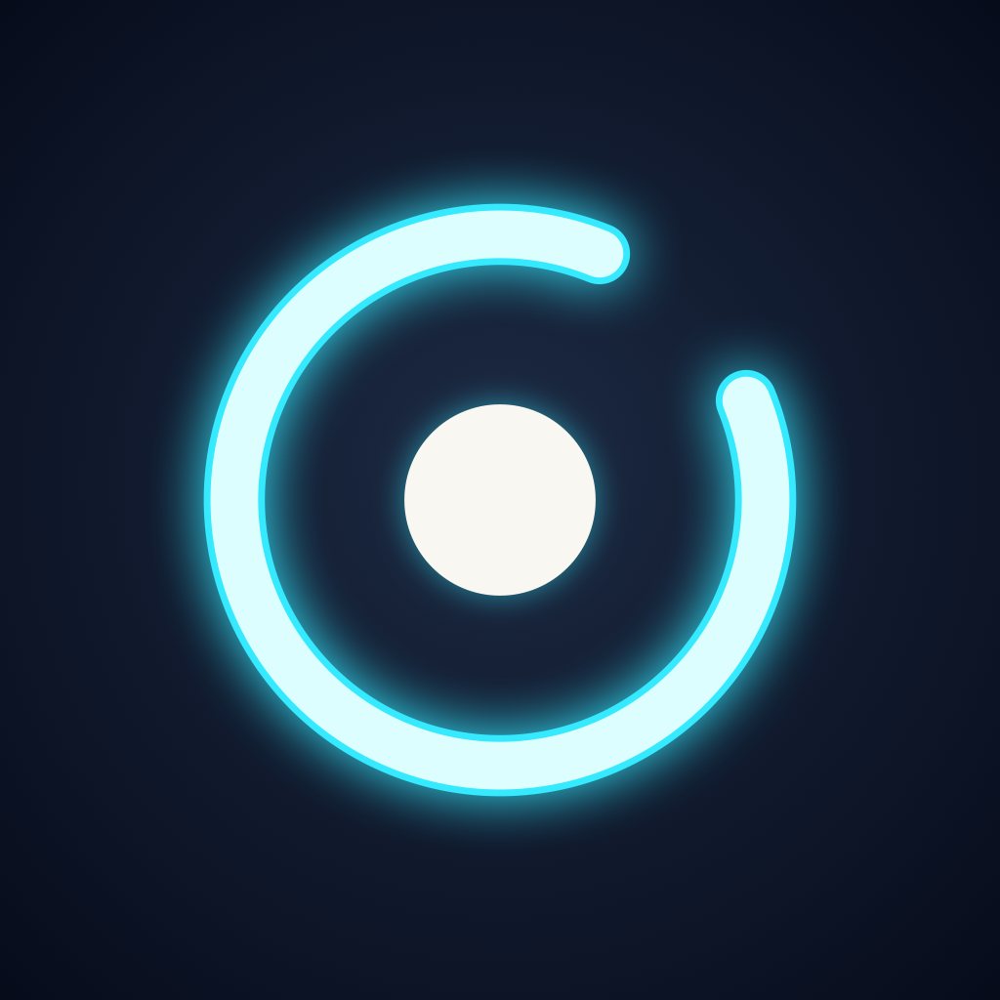
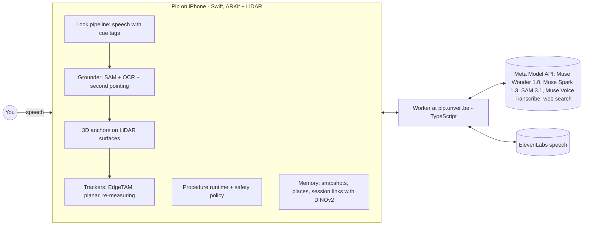

<p align="center"></p>

# Pip: points at exactly what to touch

Pip is an iPhone app you talk to while you work with your hands. It looks through the camera,
outlines the exact button, key or part in the room (locked to it in 3D, millimetre-tight), says
what to do with it, checks what happened, and remembers where things are, in this room and the
next one.

**Demo video (3 min):** [youtube.com/watch?v=zzNGSxwbZ0k](https://www.youtube.com/watch?v=zzNGSxwbZ0k) · **Track:** Indie Developer · **Theme:** Build for Your World

Built during the Meta Global AI Developer Hackathon (30 Oct – 4 Nov 2026) on Meta's models:
Muse Wonder 1.0, Muse Spark 1.3, SAM 3.1, Muse Voice Transcribe, Meta's web search tool, and, on
the phone, Meta's EdgeTAM and DINOv2.

## The problem

People get stuck on hands-on tasks every day: a coffee machine that will not start, a fuse box, a
boiler, a lift installation. The knowledge exists, in a manual or in someone's head. What fails is
applying it to the thing in front of you:

- which part the manual means;
- which of these look-alike switches, keys or pens it is;
- whether you did it right;
- where you left it.

Assistants that look through the camera describe the scene, or draw a box at best. Pip closes the
loop: it finds the source for **this exact model**, points at **this exact part**, stays on it
while you and the object move, verifies the result, and stops when something is unsafe.

## What Pip does

- **Hands-free conversation.** Live speech recognition (Muse Voice Transcribe) with echo
  cancellation, so you can talk over Pip. It starts working on its answer as soon as you stop
  talking. It switches between English and Dutch on its own.
- **Points at the exact thing.** One streamed Muse Wonder call per question answers in speech with
  inline cue tags (outline, ring, move, rotate, place, danger, landmark). Each target is found while
  the sentence streams:
  - SAM 3.1 on an enlarged crop and on the whole frame, plus on-device text recognition;
  - for small targets, Muse Spark points a second time on a zoomed crop;
  - for look-alikes, Spark picks from numbered outlines.

  Pip refuses rather than guess. Each outline is lifted onto the LiDAR surface, anchored in ARKit,
  and shown on the word it belongs to.
- **Stays locked on it.** On-device EdgeTAM follows the object at about 10 frames per second, with
  a gate that never lets the outline jump to a look-alike. Keys and buttons on a device ride along
  with the device (a planar tracker). Objects are measured again from new viewpoints and when they
  come back into view.
- **Looks it up for the exact model.** Spark with Meta's web search finds the manufacturer's manual
  or support page for the model it reads on the type plate. The answer says which models it holds
  for, and an on-screen card shows the source, with a warning when it is not the manufacturer's.
- **Guides step by step, and checks.**
  - Muse Wonder compiles a plan from the official manual, or from paper instructions held up to the
    camera, with a source reference per step.
  - A deterministic runtime owns progress: the model can never skip a step.
  - In watching mode Spark checks your work every few seconds; two positive checks in a row turn a
    step green.
  - Safety gates need an explicit yes. Hazards (spoken or seen) stop the task with an escalation.
    Medical, gas and mains-wiring tasks are refused.
- **Remembers where things are.**
  - "Remember this as my fancy pen" keeps the place, a reference photo and a description of how it
    looks.
  - "Where did I leave my keys?" searches the phone's own snapshots (Muse Wonder on contact sheets),
    finds the object in its snapshot and places it in 3D.
  - Each session's map is linked to earlier ones in the background. Matching uses described corners
    in the same light, and Meta's DINOv2 laid onto the LiDAR surfaces across a change of light. So
    Pip knows in which room you are, and says where your pen is from the bathroom ("about seven
    metres, to your right") before you see it.
  - On sight it finds that very object again, compared with its reference photo, not a look-alike
    beside it.
- **Shopping list.** It keeps a list and ticks items off when it sees them in the basket.

## How it works



- **The app** (`ios/PipApp`, SwiftUI + ARKit + RealityKit) holds the camera, the 3D anchors, the
  trackers, the memory and the conversation.
- **PipCore** (`ios/PipCore`) is a Swift package with everything that can be tested on a Mac:
  - the cue language and its validator;
  - the grounder;
  - session linking (corners, DINOv2, the home graph);
  - the procedure runtime and safety policy;
  - the network clients;
  - `pipeval`, a command-line tool that replays recordings from the iPhone through the same code.
- **The Worker** (`worker/`, Cloudflare Workers, Hono) keeps the API keys off the phone. It:
  - relays realtime speech recognition;
  - turns SAM masks into outlines;
  - checks that source links really exist;
  - forces `store: false` on chat, responses and SAM requests;
  - caps daily spend.

### Meta's models in Pip

| Model | What Pip uses it for |
|---|---|
| **Muse Wonder 1.0** | Every look (streamed speech with cue tags), compiling a plan from a manual or photos, searching the visual memory, describing a remembered object |
| **Muse Spark 1.3** | Pointing a second time at small targets, choosing between look-alikes, checking steps in watching mode, the shopping basket, web lookups of the exact model |
| **SAM 3.1** | Finding every candidate instance and its mask, by concept and by point |
| **Muse Voice Transcribe 1.0** | Realtime speech recognition with endpointing, English and Dutch |
| **Meta web search tool** | Finding the official manual or support page |
| **EdgeTAM** (on device, Core ML) | Following a pointed-at object frame by frame |
| **DINOv2 ViT-S/14** (on device, Core ML) | Recognising a room across a change of light, and which stored views show the same place |

Pip speaks with ElevenLabs Flash v2.5, with the iPhone's own voice as the fallback, and reads
printed labels with Apple's on-device text recognition.

## Measured

All measured on the iPhone 15 Pro or replayed from its recordings with `pipeval`. The full notes
are in `docs/`.

- **Pointing:** 49 recorded targets, 45 right, 4 refused, 0 wrong (`docs/research-precision.md`).
- **Tracking:**
  - EdgeTAM runs on the phone at 9-10 fps (95-102 ms a frame) while ARKit stays at 60 fps.
  - It agreed with SAM 3.1 on whether the object was in view in 77 of 77 compared frames (median
    box overlap 0.87-0.94).
  - Between updates, the 3D outline moves by a median of 0.7-2.3 mm (`docs/research-precision.md`).
- **Look-alikes:** of three pens side by side, the remembered one is found again from its reference
  photo 3 of 3 times. With the neighbour's photo, the neighbour is found 3 of 3 times
  (`pipeval ground`).
- **Spatial memory:**
  - Two sessions of one room link to within 0.4-0.8 cm per view.
  - Remembered places carried into a new session were found on sight 2.3-5.0 cm from where Pip
    pointed. From the next room, Pip said "about six metres" for a pen that was 5.9 m away.
  - Recognising a room, replayed: 25.6 s → 7.9 s, 15.2 s → 5.8 s and 12.6 s → 6.1 s after this
    week's changes. On the phone, the bedroom linked to the bathroom session 7 s after
    DINOv2 had loaded (`docs/spatial-memory.md`).
- **Tests:** 195 Swift tests (`swift test` in `ios/PipCore`) and 28 Worker tests (`npm test` in
  `worker/`).

## Built during the hackathon

- **New work only.** Everything in this repository was written during the hackathon. The first
  commit is from 30 Oct 2026, 17:34 CET, followed by more than 140 commits on `main` up to 4 Nov. No code
  comes from earlier projects. The commit history is the record.
- **Written in this repo, with no third-party libraries in the app:**
  - the cue language and its timing with speech;
  - the grounder;
  - ORB-style corner matching, RANSAC and point-to-plane ICP;
  - the Lucas-Kanade planar tracker;
  - the session links and home graph;
  - the procedure runtime;
  - the Worker.

### Third-party components

| Component | Use | Licence |
|---|---|---|
| Meta Model API (Muse Wonder, Muse Spark, SAM 3.1, Muse Voice Transcribe, web search) | Called through the Worker | Meta's API terms |
| EdgeTAM Core ML (from facebookresearch/EdgeTAM via jutsuhq/edgetam-coreml v1.2) | On-device tracking; fetched by `ios/scripts/fetch-edgetam.sh` with checksums, not in git | Apache-2.0 |
| DINOv2 ViT-S/14 (`facebook/dinov2-small`) | On-device room recognition; converted by `ios/scripts/convert-dinov2.py`, not in git | Apache-2.0 |
| `@meta-sam/parser` | Decoding SAM masks in the Worker | SAM License |
| `hono` | Worker routing | MIT |
| `wrangler`, `vitest`, `typescript`, `@cloudflare/workers-types` | Worker development | MIT / Apache-2.0 |
| ElevenLabs Flash v2.5 | Text-to-speech, through the Worker | ElevenLabs terms |
| Apple ARKit, RealityKit, Vision, Core ML, AVFAudio, CoreLocation | The app | Apple SDK |
| Cloudflare Workers | Hosting the Worker | Cloudflare terms |

## Build and run

You need an iPhone with LiDAR (tested on an iPhone 15 Pro), Xcode, XcodeGen
(`brew install xcodegen`), Node.js, a Cloudflare account on the Workers Paid plan (SAM mask decoding
needs more CPU than the free plan allows), a Meta Model API key and an ElevenLabs key.

```sh
# 1. Secrets (never committed)
cp .env.example .dev.vars        # fill in MODEL_API_KEY, PIP_APP_TOKEN, ELEVENLABS_API_KEY

# 2. The Worker
cd worker
npm install && npm test
npx wrangler deploy --secrets-file ../.dev.vars   # set your own domain in wrangler.jsonc

# 3. The app
cd ../ios
scripts/make-secrets.sh <APPLE_TEAM_ID>          # writes Config/Secrets.xcconfig
scripts/fetch-edgetam.sh                         # EdgeTAM Core ML models, checksums verified
python3 scripts/convert-dinov2.py                # DINOv2 to Core ML (torch, transformers, coremltools)
xcodegen generate
open Pip.xcodeproj                               # build and run on the iPhone
```

Set `PIP_BASE_URL` in `ios/Config/Pip.xcconfig` to your Worker's address. The app builds without
the two on-device models; it then follows objects with Apple Vision alone, and links sessions by
corners only.

Replaying recordings on a Mac: `cd ios/PipCore && swift build -c release --product pipeval`, then
for example `pipeval dinolive <memory/frames> <stored sessions> <live session>`.

### Checking it without an iPhone

The perception, the cue language, the procedures and the Worker are covered by tests that need no
phone, no keys and no network: only a Mac with Xcode, and Node.js.

```sh
# from the repository root
(cd ios/PipCore && swift test)            # 195 tests: pointing rules, tracking gates, 3D geometry, procedures, safety
(cd worker && npm install && npm test)    # 28 tests: request checks, cost pricing, link safety, SAM mask geometry
```

## Repository

| Path | What is there |
|---|---|
| `ios/PipApp` | The app: conversation, AR view, anchors, trackers, memory, screens |
| `ios/PipCore` | Swift package: perception, cues, procedures, network, `pipeval`, tests |
| `ios/scripts` | Secrets, EdgeTAM download, DINOv2 conversion |
| `worker` | The Cloudflare Worker (see `worker/README.md`) |
| `docs` | Product brief, build plan, research, measurements (`research-precision.md`, `spatial-memory.md`, `spike-results.md`) |
| `spikes/day0` | The first capability checks of Meta's models |

## Privacy and safety

- Pip asks before it keeps anything beyond the session. Snapshots stay on the phone, for a week at
  most; "Forget everything" removes them, the places, the facts and the maps.
- The Worker sends Meta's chat, responses and SAM requests with `store: false`, and caps spend
  and request rate.
- Medical, gas and mains-wiring tasks are refused by code. Hazards stop the task. Pip never says
  something is safe; it says what it saw and what you confirmed.

## Limitations

- It needs an iPhone with LiDAR.
- The app's token to the Worker is built into the app. The Worker's spend caps and rate limit are
  the guard.
- Some places take longer to recognise: rooms that look the same all round (a round table among
  identical chairs, glass walls at night). Pip asks you to look around and never guesses the room.
- Two floors are joined only once one session has walked between them.
- Not built yet:
  - importing your own PDF from the phone;
  - a screen that shows every model call of a turn (the eye button shows the build and the recent
    log);
  - resuming a task after the app was closed.
- It speaks English and Dutch only.

## Licence

MIT, see `LICENSE`. The model weights and services above keep their own licences.
